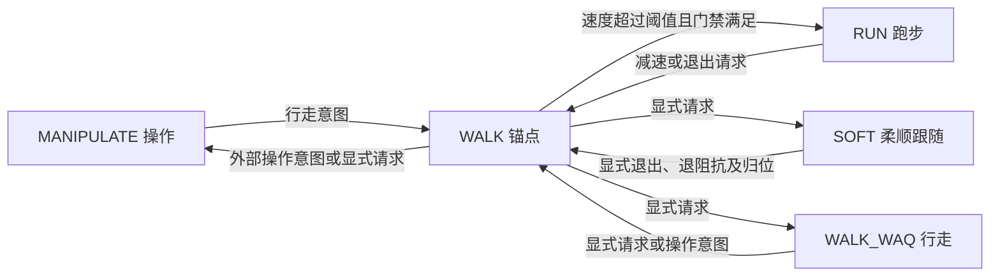

# AMP 族设计与使用

## 目标与边界

在 v55 多控制器模式中，将操作、行走、跑步、柔顺跟随和 WAQ 行走组合为一个 `amp_assemble_controller`。外层管理器只管理该装配体，族内负责成员选择，宿主复用已有的关节命令混合。其它控制器仍由原管理器独立管理。

本实现支持五种固定角色的启用、禁用和模型替换，不支持任意添加新角色或运行中热加载。新增角色需要扩展策略及装配代码。配置修改后重启控制器。

## 配置与模型

唯一族入口：`src/humanoid-control/humanoid_controllers/config/kuavo_v55/amp/amp_family.yaml`。成员 info 位于同一目录；ONNX 位于 `model/networks/`。模型改名只改变文件名，权重保持不变。

| 角色 | 控制器名称 | info | ONNX | 输入→输出 |
|---|---|---|---|---|
| MANIPULATE / M | `amp_controller` | `skw_rl_param.info` | `ampjzx260324_7_2.onnx` | 1×91 → 1×27 |
| WALK / W | `amp_wild_controller` | `skw_rl_param_wild.info` | `ampllh260708_1.onnx` | 1×91 → 1×27 |
| RUN / R | `amp_run_controller` | `skw_rl_param_run_waq.info` | `amprunwaq261016_1.onnx` | 1×910 → 1×27 |
| SOFT / S | `amp_wild_imp_controller` | `amp_wild_imp_rl_param.info` | `ampwildimp_1.onnx` | 1×910 → 1×27 |
| WALK_WAQ / Q | `amp_walk_waq_controller` | `amp_waq_param.info` | `ampwaqjzx261015_1.onnx` | 1×910 → 1×27 |

MANIPULATE 和 WALK 模型已在仓库中，保持原名并复用；其余新增文件按上述名称使用。RUN 使用当前 WAQ 导出模型，旧 RUN 备用配置不属于发布内容。SOFT 文件名不包含未经确认的训练作者或日期。

RUN 保留其现有观测构造及配置；WALK_WAQ 使用独立 `AmpWaqController`，维护 10 帧×91 维观测，初始化清零历史，完成历史预热后参与混合。不能仅因为两者输入维度相同就互换配置。SOFT 使用 `AmpWildImpController`，在普通 AMP 推理基础上增加手臂阻抗及手臂观测处理。

外层 `config/kuavo_v55/rl_controllers.yaml` 中注册：

```yaml
- name: amp_assemble_controller
  class: BASE_CONTROLLER
  type: AMP_CONTROLLER
  assembly: true
  config_file: amp/amp_family.yaml
  enabled: true
```

原有非 AMP 注册项保留。正常不再把族成员重复注册到外层循环；历史 VMP 配套的 `amp_controller_2` 保留为默认禁用的独立选项，启用该历史组合需另行验证。

### 增删成员与锚点

```yaml
anchor: amp_wild_controller
members:
  walk:
    name: amp_wild_controller
    enabled: true
    allow_direct_rl_switch: true
    config_file: skw_rl_param_wild.info
  soft:
    name: amp_wild_imp_controller
    enabled: false
    allow_direct_rl_switch: true
    config_file: amp_wild_imp_rl_param.info
```

`anchor` 只出现一次，填写成员的 `name`；当前必须指向 WALK。WALK 必须启用。其余角色设 `enabled: false` 或移除整个块即停用，不加载其配置/模型。恢复时补齐 name、config_file 并启用。禁用 MANIPULATE 后，族不接受外部动作模式请求；禁用 RUN 后不再自动切跑。

`allow_direct_rl_switch` 决定离开族去其它 RL 时能否直接以当前成员作为源；默认除 RUN 外均为 true。false 表示先回锚点，不代表拒绝退出。该参数不放宽手臂归位、混合互斥或 MPC 静止门禁。

## 族内状态机



任何两个非 WALK 成员之间经 WALK 中转。例如 S→M 为 S→W→M。每段关节混合完成后才继续下一段。SOFT 锁存，推杆或普通外部意图不会自动退出；动作播放服务会显式请求 MANIPULATE。WALK_WAQ 不会因速度变大自动切 RUN。

| 转换 | 条件 |
|---|---|
| 自动 W→R | 新鲜原始 x 指令 >`walkTorun`，绝对 yaw 指令 <`runMaxAng`；非 stance、相位有效、估计速度范数 ≥`runMinBodySpeed` |
| 自动 R→W | 新鲜原始 x 指令 <`runTowalk`；或指令过期且已经 stance；启用肘部门禁时双肘须连续进入配置范围 |
| 自动 M→W | 平移指令模长或绝对转向指令 >0.05，或存在 walk/trot 意图；没有活动外部操作，手臂交接完成 |
| W→M | 操作意图或显式请求；stance、实测速度 ≤0.05 m/s（v55 当前 manipMax） |
| W→S | 显式请求、stance |
| S→W | 显式退出、手臂偏角允许退出、完成退阻抗及归位，无活动动作 session |

默认意图保持 `intentHold=0.4 s`、最短驻留 `minDwellTime=1.0 s`、混合 `blendDuration=0.5 s`。显式请求免去自动速度触发和意图保持，但不免除物理条件、驻留、手臂就绪及混合互斥。RUN 去操作/SOFT/族间退出时会屏蔽速度意图，等待停稳后回 WALK。

速度判断使用原始 `/cmd_vel`，与各模型的输入缩放分开。实测速度取躯干三维线速度范数。指令过期不等于停车超时；stance 是接收器命令状态，不单独证明物理静止。全部参数的单位、边界及影响见 YAML 内注释。

### RUN→WALK 被动肘部检测

`switching.runToWalkElbowGuard` 只在 RUN 需要切到 WALK（含显式请求或去其它成员的中转）时检查。双肘没有同时进入行走范围时，执行成员仍为 RUN，不启动 WALK 或关节融合；RUN 继续按现有速度指令推理，自行随减速降低摆臂幅度。此功能不发手臂归位、锁臂、模式切换或额外减速命令。

v55 使用原始关节反馈零基索引 `[16,23]`。当前调试闭区间为左右肘各 `[-0.55,0.2] rad`，要求连续 `0.1 s` 在范围内；不要求肘部速度为零，以允许自然摆动。该范围需通过低速 RUN/WALK 实机录包校准，不代表已经验证的安全边界。任一侧越界、缺失/非有限值、时间戳倒退或超过 `maxSampleAge` 的旧数据/采样间断会重置计时；同一帧重复评估不累积时间、也不刷新接收时刻。样本年龄按控制器收到新时间戳的 ROS 时刻计算，保持时间取传感器时间和接收时间累计量的较小值，兼容仿真与 ROS 时钟偏移。意图撤回、暂停、重置及切换完成也清掉检测历史。

门禁没有超时强制放行；等待期间保留已有故障处理。满足肘部条件还需满足原有意图、驻留及其它门禁，才开始正常融合。融合开始后不因某一帧摆臂越界突然回退，避免另一次输出切换。未配置该功能的其它族保持旧行为。

`/humanoid_controller/amp_family/status` 的 `run_walk_elbow_guard` 给出索引、实测角度、上下界、样本时间/新鲜度、是否在范围内及剩余保持时间。`reason` 为 `waiting_run_walk_elbow_sample`（数据无效/过期）、`waiting_run_walk_elbow_range`（至少一肘越界）或 `waiting_run_walk_elbow_hold`（尚未持续到位）；`applicable=false` 时这些到位字段不用于判定。

### v55 WALK/RUN 指令口径

当前 WALK 的 x/y/yaw 倍率为 1/1/1，原始输入量程为 1.1 m/s、±0.55 m/s、±0.5 rad/s；RUN 的倍率也为 1/1/1，量程为 2.0 m/s、±0.5 m/s、±0.5 rad/s。配置来源分别为 `amp/skw_rl_param_wild.info`、`amp/skw_rl_param_run_waq.info`，实际运行值在节点初始化时加载，修改后需重启。

WALK/RUN 的 x/y/yaw 指令倍率及 command_scalar_state.obsScales 均为 1；在相同接收器指令、忽略其它修正时，不再因这些倍率不同产生模型输入跳变。两者的输入端量程仍不同（尤其 x：1.1 与 2.0），固定摇杆位置下切换仍可能改变原始 /cmd_vel；不能据此保证整个指令链路连续。其它模型的倍率保持各自配置。

`walkTorun/runTowalk` 始终比较原始 `/cmd_vel`，不要按模型倍率换算。这些阈值和肘部范围是可调参数，软件检查通过不代表已经验证实机运动稳定性。`switching` 按 WALK→RUN、RUN→WALK、MANIPULATE→WALK、操作/退出及通用参数分组布局，仍使用同层键，跨方向共用参数不复制。阈值以 `amp_family.yaml` 为准；WALK 原始正向量程降到 1.1 后，若恢复 walkTorun=1.6，正常遥控器输入将无法触发自动切跑。

`velocityLimits` 用于向遥控器等输入端发布量程，不应视为对所有直接 `/cmd_vel` 发布者的统一限幅保证。负向 x 还保留 `cmdVelLineXNegScale=0.4`；倍率改为 1 不表示取消后退缩放。族内切换只读取 YAML，成员 `.info` 中 `autoControllerSwitch` 是独立控制器的兼容配置。

## 请求接口与动作

WALK/MANIPULATE 仲裁中，活动或待交接的外部操作意图优先于普通成员选择；
此时拒绝非 MANIPULATE 成员请求，并在 MANIPULATE 内保持行走通道关闭。
MANIPULATE 操作期间保持 stance，不因手臂运动引起的身体速度波动恢复零速踏步。
MANIPULATE 离开前及其到行走成员的混合期间保持 stance，混合完成后才放行行走；
WAQ/WALK 收到操作意图时也保持 stance（包括经 WALK 中转），实测低速门禁仍用于进入 MANIPULATE。
站立、实测速度、驻留、混合及手臂交接门禁仍然生效。SOFT 锁存和族退出规则保持原行为。
稳定 SOFT 下，显式成员请求可清除背景操作消息留下的锁存并按正常归位流程退出；
真实动作、待交接 MANIPULATE 请求、混合或外部手臂模式交接期间不适用此例外。

按名称请求成员使用 `/humanoid_controller/switch_controller`，名称见成员表。服务成功表示请求受理，不表示混合完成。

WALK_WAQ 专用入口：

```bash
rosservice call /humanoid_controller/amp_family/switch_to_walk_waq "{}"
```

SOFT 切换入口：

```bash
rostopic pub -1 /humanoid_controller/soft_switch_request std_msgs/Empty '{}'
```

在 AMP 装配体下，非 Roban 的 LB+RB 上升沿请求 SOFT；再次操作请求退出。其它控制器保留原组合键行为，Roban 保留原搬运/起身处理。

动作播放服务（`arm_trajectory_bezier_process.py`）支持 SOFT 下直接请求动作：


动作端要求 1 秒内接收的族状态满足：active_member 为 amp_controller、family_active=true、blending=false、exiting=false、external_allowed=true。不能只看成员名，因为混合开始时名称已切到目标。

族交接等待默认 10 秒，由动作节点私有参数 `~amp_family_action_switch_timeout` 配置。停止行走、手臂模式确认另有等待时间。交接轮询采用单调墙钟；ROS 服务阻塞仍受服务响应影响。超时、拒绝或中断取消本次动作，不缓存稍后播放；已受理的成员切换请求不会因此撤销。直接发布底层轨迹不经过上述流程。

## 混合、SOFT 与独立性

装配体不重复推理，而是管理真实成员实例。宿主在混合期间保留源和目标，混合结束再暂停源；历史预热完成才能提交。WALK↔RUN 保留关节混合但跳过额外速度凹陷，避免人为减速。成员指令历史交接避免 WALK 缩放与 RUN 缩放相互污染。

共享 `/rl_controller/InputData/...` 只保留当前目标成员的观测，避免双模型并行时交错曲线。各成员独立诊断在 `/rl_controller/<member>/InputData/...`。模型输入的不同缩放仍可能造成目标输入数值变化，不能直接用两种模型的缩放值比较物理速度。

SOFT 的模式 3/4、阻抗增益、观测修正均需显式配置；默认不开启。退出时退阻抗、归位并平滑交接，作为族间混合源恢复运行时不再重入阻抗。共享基类增加的族接口默认保持原控制器行为；严格物理静止检查只用于 AMP→MPC。启动文件统一通过 `/rl_controllers_config` 指向 `config/kuavo_v<版本>/rl_controllers.yaml`，不判断机型选择 AMP 目录。各控制器的 info 路径由注册表配置。未提供新参数或值为空时，兼容旧 `/rl_param` 的两级父目录推导；显式注册表优先。新启动文件保留 `rl_param` 参数（默认空），若需要旧方式指定路径，同时将 `rl_controllers_config` 设为空。

## 族间与故障处理

AMP→MPC 必须同时满足零速意图、stance、有效新鲜状态、身体静止、手臂交接完成及没有混合。物理快照检查线速度/角速度、足底接触及状态估计稳定性，待提交时再次检查。运动中请求 MPC 会被拒绝，不因 `allow_direct_rl_switch=true` 放行。

AMP 的倒地判定为 roll 或 pitch 绝对值 >60°（当前硬编码，无持续时间过滤）。装配体转发当前成员的倒地请求。主循环记录 FALL_DOWN 后：

- 加载 FallStand 且切换成功：进入该控制器并暂停 MPC。
- 未加载或切换失败：发布 `/stop_robot=true` 并立即返回，不再生成本轮后续输出。

倒地不通过 MPC 兜底，避免被正常静止门禁拦住。v55 默认未加载 FallStand，因此走停机请求分支。停机依赖现有接收链路执行，不代表自动起身。

WAQ 的非法观测、非有限输出及推理异常会锁存故障并请求停机；宿主检查当前和混合源的故障。普通 AMP 成员尚未统一实现与 WAQ 完全一致的推理故障锁存。缺失/异常传感器的全面故障策略仍是后续工作，不能把倾角检测视为完整安全系统。

## 诊断与仿真拉力

```bash
rostopic echo /humanoid_controller/amp_family/active_member
rostopic echo /humanoid_controller/amp_family/status
rostopic echo /humanoid_controller/amp_family/controller_type
```

status 为 JSON，包含 anchor_member、enabled_members、active_member、requested_member、desired_member、next_member、blending、exiting、reason，以及指令新鲜度、身体速度、stance、相位和等待时间。`active_member` 在混合开始即变更；以 blending=false 判断混合完成。SOFT 的 walking_allowed=false 表示屏蔽速度输入，不代表腿部推理停止。

`/humanoid_controller/amp_family/controller_type` 为 `std_msgs/Int8`，替代原来的走跑二值话题。编码固定按角色分配，禁用成员或修改成员 name 均不重排；族未激活或无法识别时为 0。

| 编码 | 角色 | 默认控制器名称 |
|---|---|---|
| 1 | manipulate | `amp_controller` |
| 2 | walk（锚点） | `amp_wild_controller` |
| 3 | run | `amp_run_controller` |
| 4 | soft | `amp_wild_imp_controller` |
| 5 | walk_waq | `amp_walk_waq_controller` |

与 status 一起约 5 Hz 发布，切换开始、完成、回退及暂停时立即发布，并保留最近值供新订阅者读取。数值跟随 `active_member`，在混合开始时变为目标编码，不表示混合已经完成；RUN→WALK 等待肘部门禁时仍为 3，混合开始后为 2。判断交接完成还需检查 `status.blending=false`。status 中的 `controller_type` 及 `members[].controller_type` 分别提供当前编码和成员编码表。

族角色键使用 `members.walk_waq`，显式目标名称使用 `amp_walk_waq_controller`，专用服务使用 `switch_to_walk_waq`。更新时须同步修改外部脚本与录包列表。族阈值已更名为 `walkTorun`、`runTowalk`；旧键会明确报错，避免误用默认阈值。成员 info 内独立控制器使用的旧版 `autoControllerSwitch` 不参与族切换，保持原接口。

MuJoCo 中可双击手/前臂选中刚体，按 Ctrl+右键拖动施加平移扰动。定量测试使用 `/external_wrench/left_hand` 或 `/external_wrench/right_hand`，世界坐标系力单位 N、力矩单位 N·m：

```bash
# 左手 +X 方向 5 N，仿真会持续保持最后一次消息。
rostopic pub -1 /external_wrench/left_hand geometry_msgs/Wrench \
  '{force: {x: 5, y: 0, z: 0}, torque: {x: 0, y: 0, z: 0}}'
# 停止发布并不会撤力，结束必须发零；双手施力时两侧都要清零。
rostopic pub -1 /external_wrench/left_hand geometry_msgs/Wrench \
  '{force: {x: 0, y: 0, z: 0}, torque: {x: 0, y: 0, z: 0}}'
```

`/hand_wrench_cmd` 是控制目标，不是上述仿真外力。身体不跟随时检查：SOFT 已激活且混合结束、手臂偏转进入模型观测、未启用影响身体移动的躯干吊绳。动作测试前先撤力，让退阻抗与归位条件满足。

## 验证范围与发布内容

已开展 CPU 模型尺寸/有限输出检查、真实成员推理和族内 20 条有向切换路径、16 种成员启用组合、管理器 MPC 门禁、动作交接及倒地分支回归。隔离测试采用合成状态、模拟混合完成，不等同于完整动力学或实机验收。已复现旧倒地出口被 MPC 门禁阻塞，并用主循环实际分支测试验证新增停机出口。

本次上传仅包含运行代码、v55 AMP 配置、必要 ONNX 和本设计文档。测试脚本、审计报告、迁移过程文档、未使用模型及本地启动偏好不纳入。与 VMP 等控制器的实际闭环切换、SOFT 拉拽跟随效果、倒地后的真实停机接收链路仍需单独验收。
