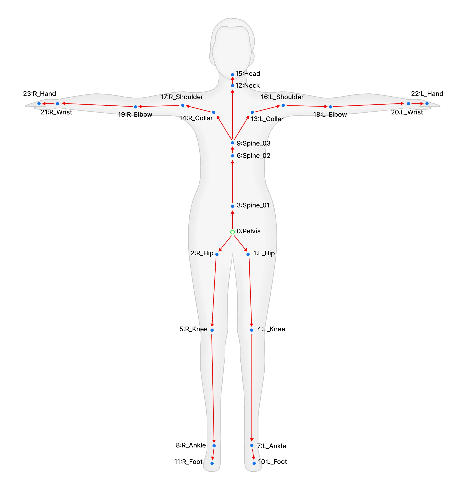
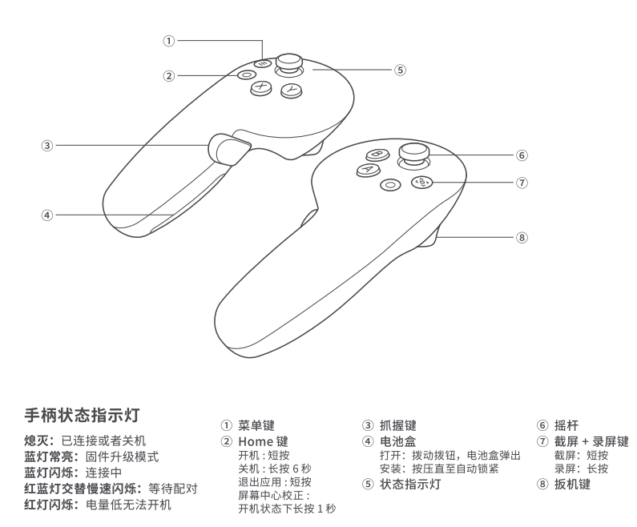

# Pico 全身遥操作

## 快速开始（5代 / 5W）

本 README 统一说明实时 PICO 遥操的启动、连接校准、手柄操作。操作流程见[连接与操作](#连接与操作)，按键见[手柄操作说明](#手柄操作说明)。

启动前确认工作区已编译，当前终端已加载工作区环境和实际机型的 `ROBOT_VERSION`。**如果 `.bashrc` 已配置，无需重复执行下面的环境命令**；否则在工作区根目录执行：

```bash
source devel/setup.bash
export ROBOT_VERSION=62  # 5W版本示例；5代v53填53，以实际机型为准
```

**实机启动：**

```bash
roslaunch humanoid_controllers load_kuavo_with_pico_vr.launch
```

**仿真启动：**

```bash
roslaunch humanoid_controllers load_kuavo_with_pico_vr.launch sim_mode:=true
```

两种启动方式二选一，不要同时启动多套PICO接收程序。总入口已默认开启 `with_mm_ik`，无需重复传入；控制范围默认5W为 `UpperBody`、5代双足为 `LowerBody`，启动后按[手柄操作说明](#手柄操作说明)切换，不必固定写在启动命令中。

> 不带 `sim_mode:=true` 的命令启动**实物分支**。仿真前确认ROS主节点没有连接实机；实机测试须确认机器人版本、现场防护、急停和底层初始化，并使用现场规定的运行账号及其环境。不要为通过测试关闭关节保护或命令保护。

### 关键参数

| 参数 | 作用及注意事项 |
|---|---|
| `robot_version` | 底层与PICO共用的内部版本；未指定时读取已导出的`ROBOT_VERSION`，总入口和独立入口未配置时均回退到40。启动前确认机型正确；临时覆盖时可传`robot_version:=实际版本号`。 |
| `wheel_robot` | 根据版本自动计算，决定双足/轮臂启动分支；不是遥操解锁开关。 |
| `sim_mode` | `true`为仿真，`false`为实物。 |
| `start_robot` | 默认`true`；设为`false`只是不启动底层，**仍会启动PICO并可能输出控制命令**。 |
| `enable_head_control` | 默认`true`，控制独立头控节点是否启动；不是整条遥操的安全隔离开关。 |
| `pico_control_mode` | 控制范围：`UpperBody / LowerBody / WholeBody`。总入口默认5W为UpperBody，双足为LowerBody。不是绝对/增量算法选择。 |
| `with_mm_ik` | 总入口默认`true`，无需重复传入。5代控制独立MM节点启动，增量/MM路线需要它；follow独立IK是另一条路线。当前5W子launch只声明此参数、没有引用它控制启动，不能用它开关轮臂原生MPC。 |
| `head_control_mode` | 默认`vr_follow`；还支持`fixed / auto_track_active / fixed_main_hand`。 |

### 底层已经启动时

不要再次使用默认的一键总入口。确认当前终端的 `ROBOT_VERSION` 与已运行的底层一致，并确认控制依赖已启动，再单独启动PICO：

```bash
roslaunch noitom_hi5_hand_udp_python launch_pico_teleop.launch
```

注意：这个独立入口默认是 `LowerBody`，不会像总入口一样自动为5W选择 `UpperBody`。需要上半身控制时可通过手柄切换，也可启动时追加 `control_mode:=UpperBody`。5代增量/MM路线还需确认独立MM节点已启动。

头控运行时接口见下方头控说明；实时遥操操作见[连接与操作](#连接与操作)。GMR、诊断和回放属于另外的使用场景，**不是5W日常PICO遥操的必需启动步骤**。

### GMR 模式下灵巧手控制

当使用 `load_kuavo_real.launch with_pico_gmr:=true` 启动 GMR 链路时，灵巧手控制由
独立的 `pico_dexhand_control` 节点自动提供（默认启用），无需额外启动 `pico_whole_body_teleop`。

> **背景说明**：`pico_whole_body_teleop` 和 `pico_comm_minimal` 都会绑定 UDP 12345 端口，
> 不能同时运行。`pico_dexhand_control` 节点不占用任何端口，仅订阅 `/pico/joy` 话题。

```bash
# GMR + 灵巧手（默认已启用灵巧手）
roslaunch humanoid_controllers load_kuavo_real.launch with_pico_gmr:=true with_mm_ik:=true

# 如需关闭 GMR 模式下的灵巧手控制
roslaunch humanoid_controllers load_kuavo_real.launch with_pico_gmr:=true with_mm_ik:=true pico_enable_dexhand_control:=false
```

**GMR 模式灵巧手支持的按键**：
| 按键 | 功能 |
|------|------|
| 左/右 Grip（连续值） | 灵巧手抓握控制 |
| Y | 锁定/解锁手指输出 |
| X 长按（LT/RT 空闲时） | 左拇指张开切换 |
| A 长按（LT/RT 空闲时） | 右拇指张开切换 |

如需启用迁移后的 PICO 主动手头控（独立节点）：

> **GMR 模式下自动启动**：使用 `load_kuavo_real.launch with_pico_gmr:=true` 时，头控节点默认自动启动，无需手动运行。
> `pico_comm_minimal` 会发布 `/robot_body_matrices`，头控节点订阅该话题实现头部跟踪。

```bash
# GMR + 灵巧手 + 头控（默认全部启用）
roslaunch humanoid_controllers load_kuavo_real.launch with_pico_gmr:=true

# 切换头控模式（默认 auto_track_active）
roslaunch humanoid_controllers load_kuavo_real.launch with_pico_gmr:=true pico_head_control_mode:=vr_follow

# 关闭 GMR 模式下的头控
roslaunch humanoid_controllers load_kuavo_real.launch with_pico_gmr:=true pico_enable_head_control:=false
```

如需单独运行头控节点（调试用）：
```bash
sudo su
cd kuavo-ros-opensource
source devel/setup.bash
cd src/manipulation_nodes/pico-body-tracking-server
python3 scripts/pico_head_control_node.py _mode:=auto_track_active
```

说明：
- 该节点会发布 `/robot_head_motion_data`，并自动设置 `/pico/use_external_head_control=true`，避免与旧链路重复发布。
- 支持模式：`fixed`、`auto_track_active`、`fixed_main_hand`、`vr_follow`。
- 可通过话题 `/pico/head_control_mode`（`std_msgs/String`）在运行时切换模式。
- 头控服务接口：`/pico/set_head_control_mode`（`kuavo_msgs/SetHeadControlMode`）。

头部控制服务接口：
- 服务名：`/pico/set_head_control_mode`
- 服务类型：`kuavo_msgs/SetHeadControlMode`
- 请求字段：
  - `mode`：`fixed` / `auto_track_active` / `fixed_main_hand` / `vr_follow`
  - `fixed_hand`：仅 `fixed_main_hand` 时必填，`left` 或 `right`
- 响应字段：
  - `success`：是否成功
  - `message`：错误或成功信息
  - `current_mode`：当前生效模式

示例：
```bash
# 固定模式
rosservice call /pico/set_head_control_mode "{mode: 'fixed', fixed_hand: ''}"

# 自动跟踪主动手
rosservice call /pico/set_head_control_mode "{mode: 'auto_track_active', fixed_hand: ''}"

# 固定主手（左手）
rosservice call /pico/set_head_control_mode "{mode: 'fixed_main_hand', fixed_hand: 'left'}"

# VR随动
rosservice call /pico/set_head_control_mode "{mode: 'vr_follow', fixed_hand: ''}"
```

灵巧手迁移说明（PICO）：
- 已对齐“抓握 + 锁定/解锁”的控制链路，按键逻辑保持不变（`Y` 锁定/解锁）。
- 新增抓握配置项在 `config/pico_vr_config.yaml` 的 `dex_hand` 下：
  - `command_min` / `command_max`：抓握输出范围
  - `smoothing_alpha`：抓握平滑系数
  - `grip_deadzone`：抓握死区
  - `stable_unlock.enabled` / `stable_unlock.reengage_threshold`：解锁回切防突变阈值

### Pico App 端启动

打开2个体感追踪器，会闪蓝光，佩戴到左右脚踝处，注意裤子不要遮挡传感器，必要时可以卷起裤脚。

进入 Pico，点击任意左右手柄`HOME`按键，可以看到下方的菜单栏，在左下角**点击打开资源库**，找到并打开**LejuVRTeleopRobot**应用，找不到的话可以看看未知来源的分类。

进入 App，进行校准:
 - 选择全身追踪-->立即校准
 - 或者右上角的立即校准

校准成功，可以在视野前方出现一个由绿色方块组成的人形，可以随意运动看看人形的动作是否一致，如果不一致建议重新校准。

### 遥操作

在 App 左手方向，机器人服务器下拉列表找到对应的机器人，选择连接，点击遥操作即可开始遥操。

**初始时，遥操处于上锁状态，可以通过同时按下左手柄的上下扳机解锁。**

**总入口默认5代为下半身、5W为上半身；以启动参数为准。`RT+X`切全身，`RT+B`切上半身，`RT+A`切下半身。解锁不会自动切换控制范围，也不会自动选择绝对/增量模式。**

5W基础测试保持UpperBody，不使用双足脚步流程。

更多按键切换功能请参阅后续章节。

## full-body-tracking-pose 说明

人体参考图：



full-body-tracking-pose 的骨骼节点说明：
```python
body_tracker_role = [    
    "Pelvis",
    "LEFT_HIP",
    "RIGHT_HIP",
    "SPINE1",
    "LEFT_KNEE",
    "RIGHT_KNEE",
    "SPINE2",
    "LEFT_ANKLE",
    "RIGHT_ANKLE",
    "SPINE3",
    "LEFT_FOOT",
    "RIGHT_FOOT",
    "NECK",
    "LEFT_COLLAR",
    "RIGHT_COLLAR",
    "HEAD",
    "LEFT_SHOULDER",
    "RIGHT_SHOULDER",
    "LEFT_ELBOW",
    "RIGHT_ELBOW",
    "LEFT_WRIST",
    "RIGHT_WRIST",
    "LEFT_HAND",
    "RIGHT_HAND",
]
```

手柄参考图：

  

## 手柄操作说明

### 按键定义对照表

| 缩写 | 英文全称 | 中文名称 | 按键类型 |
|------|----------|----------|----------|
| LT   | Left Trigger | 左扳机 | 扳机键 |
| RT   | Right Trigger | 右扳机 | 扳机键 |
| LG   | Left Gripper | 左抓握键 | 按键 |
| RG   | Right Gripper | 右抓握键 | 按键 |
| X    | X Button | X按钮 | 功能键 |
| Y    | Y Button | Y按钮 | 功能键 |
| A    | A Button | A按钮 | 功能键 |
| B    | B Button | B按钮 | 功能键 |

### 模式切换功能
以下按键组合用于在不同的遥操模式之间切换：

| 按键组合 | 功能描述 | 操作说明 | 备注 |
|----------|----------|----------|------|
| **RT+X** | 全身遥操模式 | 按右扳机 + 点按X键 | 切换到全身遥操作模式 |
| **RT+B** | 上半身遥操模式 | 按右扳机 + 点按B键 | 切换到上半身遥操作模式 |
| **RT+A** | 下半身遥操模式 | 按右扳机 + 点按A键 | 切换到下半身遥操作模式 |
| **RT+Y** | 躯干模式切换 | 按右扳机 + 点按Y键 | 切换躯干控制模式 |

#### 遥操模式说明
- **WholeBody全身遥操模式**: 同时控制机器人的上半身和下半身动作
- **UpperBody上半身遥操模式**：控制上半身；5代在关闭躯干控制后可另用摇杆行走，不能理解为腿部始终不动。
- **LowerBody下半身遥操模式**: 仅控制机器人的下半身动作，上半身保持默认姿态
- **躯干模式**: 启用或禁用躯干控制功能， 仅在上半身遥操模式下有效，机器人会自动根据手末端的位置调整躯干高低, **5代控制躯干时无法使用左右摇杆控制行走和旋转；5W摇杆走独立轮臂分支**

### 摇杆与按键操作（5代 / 5W）

#### 摇杆控制

**5代：**仅在 `UpperBody` 且关闭躯干控制时使用摇杆；`WholeBody / LowerBody` 下摇杆不控制行走。

**5W：**解锁遥操后使用摇杆移动底盘，无需按 B 踏步；日常操作保持 `UpperBody`。

- **左摇杆**：前进后退 + 左右横移。
- **右摇杆**：左右推动控制旋转；前后推动无响应。

| 速度上限（正反方向） | 5代 | 5W 默认值 |
|---|---|---|
| 前后 | 0.4 m/s | 0.4 m/s |
| 横移 | 0.2 m/s | 0.4 m/s |
| 旋转 | 0.4 rad/s | 0.25 rad/s |

5W 启动时读取 `/vr_cmd_vel/linear_scale_x`、`linear_scale_y`、`angular_scale_z`（后两项同属 `/vr_cmd_vel/`）；未配置时使用上表默认值，修改后需重启 PICO 节点。

#### 按键功能表（5代 / 5W 共用）

除备注中的机型及模式限制外，下列按键共用。`LT/RT` 是左/右扳机，`LG/RG` 是左/右抓握键。

| 按键组合 | 功能描述 | 操作说明 | 备注 |
|----------|----------|----------|------|
| **LT+LG** | 解锁遥操 | 同时按住左扳机和左抓握键 | 不会自动切换身体控制范围或手臂算法模式 |
| **RT+RG** | 锁定遥操 | 同时按住右扳机和右抓握键 | 5W 锁定后停止 PICO 底盘速度输出，不保证立即停车；遥操锁不代替物理急停 |
| **LG/RG** | 末端抓握控制 | 单独按下左/右抓握键 | 左右手独立控制，需对应末端支持 |
| **LT+A** | 末端力控制 | 按住左扳机，再点按 A | 解锁后可用；`LowerBody` 下不可用，需底层支持 |
| **A** | 初始化启动 | 单独点按 A | 5代 / 5W 均调用初始化服务，相当于终端输入 o；不是遥操解锁 |
| **B** | 5代开始踏步 | 单独点按 B | 5代仅在 `UpperBody` 且关闭躯干控制时使用；5W 移动不需要此步骤 |
| **Y** | 抓握状态锁定 | 点按 Y | 切换抓握状态的锁定/解锁 |
| **X+Y** | 软件紧急停止 | 同时按下 X 和 Y | 不代替现场物理急停 |
| **LT+Y** | 手臂复位/外部控制 | 按住左扳机，再点按 Y | 切换手臂复位与外部控制状态 |
| **LT+X** | 增量操控开启/暂停 | 按住左扳机，再点按 X | 先在 App 进入增量模式；`LowerBody` 下不可用，不需持续按住 |
| **X_LONG** | 左拇指张开切换 | 长按 X | 左拇指张开/恢复，需对应末端支持 |
| **A_LONG** | 右拇指张开切换 | 长按 A | 右拇指张开/恢复，需对应末端支持 |

补充说明：
- 单独点按 X 的录制功能暂不支持。
- `LT+RT+A_LONG` 为停止序列：同时按住左右扳机并长按 A。它不是解锁操作，也不是5W日常启动步骤。

头显端按钮显示不代替机器人日志；5W基础流程见[连接与操作](#连接与操作)。

## 连接与操作

### 使用前确认

- 使用已编译的工作区，同一环境只运行一套 PICO 接收程序。
- 先仿真，再实机。核对 `ROS_MASTER_URI`、节点和 `/real`，确保仿真主节点未连接真实执行器，不能只凭 MuJoCo 窗口判断已经隔离。
- 实机另行确认机型、底层初始化、现场防护、观察者和可达的急停；软件遥操锁不是物理急停。

PICO 与接收电脑需网络互通，在 App 中选择接收电脑实际可达的 IP。按[App 启动说明](#pico-app-端启动)完成校准，确认显示的人体动作与实际动作一致后再进行遥操。

### 分清三个层次

```text
遥操锁定/解锁     身体控制范围                  手臂算法模式
LT+LG / RT+RG     UpperBody/WholeBody/LowerBody   follow/incremental/mobile_mpc
      |                    |                             |
是否处理骨骼输入     是否处理手臂、脚部输入          目标生成方式与输出接口
```

5W 使用时保持 `UpperBody`，不要为了移动底盘切成 `LowerBody`。初始手臂算法模式为 `mobile_mpc`；按当前实测 App 的操作，从初始模式切换两次进入增量模式，以界面显示的 `incremental` 或接收端“进入增量模式”日志为准。解锁不会自动切换算法模式。

### 手臂操作

- **跟随模式 `follow`：**在 App 中选择跟随模式，解锁遥操并将手臂切到外部控制，再移动双手进行操作。
- **增量模式 `incremental`：**在 App 中进入增量模式，解锁遥操并开启增量操控，再移动双手进行操作。

**增量操控开启/暂停：**在 App 中进入增量模式后，按住左手柄扳机并点按 X 键（`LT+X`），切换开启或暂停；不需要持续按住。

### 移动：不要混用5代与5W流程

| 机型/范围 | 输入方式与操作 |
|---|---|
| 5代 UpperBody | 关闭躯干控制，单按 B 请求 walk；摇杆控制移动，松开摇杆后单按 A 请求 stance。 |
| 5代 WholeBody / LowerBody | 使用人体脚部动作检测，不使用摇杆行走；不能把摇杆无响应当作通信断开。 |
| 5W | 完成初始化并解锁后使用摇杆，不需要双足 B 踏步/A 切站立步态流程。 |

左摇杆控制前后、横移，右摇杆横向控制转向。初次操作请小幅推动摇杆，确认移动与停止响应后再扩大范围。五代全身/下半身模式按 A 会先请求约 2 秒 walk 再请求 stance；遥操锁也不是行走急停。

## 机器人延迟诊断功能

**注意: 进行延迟诊断功能时会自动上锁遥操，结束后需要您手动通过组合键重新解锁，才能继续遥操!**

**注意: 进行延迟诊断功能时会自动上锁遥操，结束后需要您手动通过组合键重新解锁，才能继续遥操!**

**注意: 进行延迟诊断功能时会自动上锁遥操，结束后需要您手动通过组合键重新解锁，才能继续遥操!**

本功能用于诊断机器人执行延迟情况（非网络延迟），一定程度上可反应当前遥操的效果情况，您可以在 VR App 中点击按钮开启对应的功能。

在延迟诊断过程中，无法使用遥操功能，结束后需要您手动通过手臂组合键重新解锁，才能遥操!

## 录制播放功能

### 录制功能
使用 `robot_pico_recorder.py` 脚本可以录制机器人控制数据，支持录制以下话题：
- `/ik/two_arm_hand_pose_cmd` - 双臂手部位姿命令
- `/mm/two_arm_hand_pose_cmd` - 移动操作手部位姿命令  
- `/humanoid_mpc_foot_pose_world_target_trajectories` - 人形机器人足部轨迹

### 录制其他话题

如果需要录制额外的话题，在 `pico-body-tracking-server/config/extra_bag_topics.json` 配置需要额外保存的话题

```json
[
  "/sensors_data_raw"
] 
```

#### 录制命令
```bash
# 录制控制数据到指定bag文件
python3 robot_pico_recorder.py record <bag文件名>

# 示例：录制到 my_control_session.bag
python3 robot_pico_recorder.py record my_control_session.bag
```

### 播放功能

> 以下为原有回放说明，不代表回放脚本已完成5W适配。它与实时PICO入口不是同一个程序；5W基础测试不执行回放，需另行审查服务和坐标契约。

播放录制的控制数据，自动调用必要的控制服务：
- `/change_arm_ctrl_mode` - 切换手臂控制模式
- `/mobile_manipulator_mpc_control` - 启用移动操作MPC控制
- `/enable_mm_wbc_arm_trajectory_control` - 启用手臂轨迹控制

#### 播放命令
```bash
# 播放录制的bag文件
python3 robot_pico_recorder.py play <bag文件名>

# 示例：播放 my_control_session.bag
python3 robot_pico_recorder.py play my_control_session.bag
```

### 使用场景
- **动作录制**: 录制复杂的机器人操作序列
- **动作回放**: 重复执行录制的操作
- **教学演示**: 录制标准操作流程用于教学
- **调试分析**: 录制问题场景用于后续分析

### 注意事项
- 录制时确保网络连接稳定
- 播放前检查机器人状态和安全
- 录制的bag文件包含时间戳信息
- Ctrl+C中断录制/播放

## 接口文档

详情见 docs/api_docs.md, [文档链接](./docs/api_docs.md)

